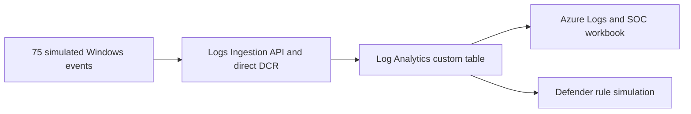
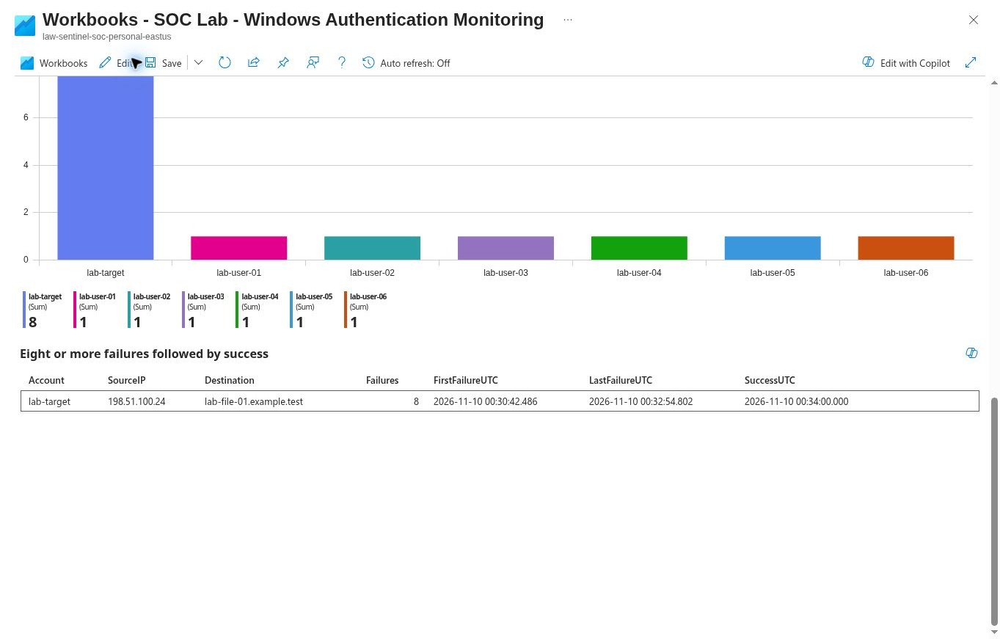

# Microsoft Sentinel SOC lab · Windows authentication triage

This lab investigates a simulated Windows authentication sequence using data indexed in Azure Monitor Logs. It demonstrates custom log ingestion, record reconciliation, KQL triage, a saved Sentinel workbook, and Defender's built-in analytics rule simulation.

## Architecture

**Technologies** · Microsoft Sentinel, Azure Monitor Logs, Log Analytics, direct Data Collection Rule, Entra ID, KQL, Azure Workbooks, and Microsoft Defender.

## Findings

| Evidence | Observed result |
|---|---|
| Source reconciliation | 75 unique records matched across all 13 source fields. Zero missing, extra, duplicate, or mismatched rows in the batch window. |
| Authentication outcomes | 61 successful Windows logons (4624) and 14 failed logons (4625). |
| Correlated sequence | Eight failures for `lab-target` from `198.51.100.24` to `lab-file-01.example.test` preceded a success at **00:34 UTC on November 10, 2026**. |
| Workbook | Four saved panels displayed totals, trends, failures by account, and the sequence. |
| Defender rule simulation | The historical evaluation chart showed a matching result using an eight-failure threshold. No scheduled rule was deployed. Live alert and incident generation were untested. |

[Workbook overview](evidence/workbook/12-workbook-overview.jpg) · [Trend chart](evidence/workbook/14-workbook-trend.jpg) · [Exact record reconciliation](evidence/ingested/07-source-verification.jpg) · [Defender simulation](evidence/detection/11-rule-simulation.jpg)

## Reproduce

1. For a quick review, run the numbered queries in [kql/inline](kql/inline) in Azure Logs KQL mode. The events are embedded in the queries.
2. To reproduce the ingested workflow in an authorized lab, use the [architecture and ingestion walkthrough](docs/WALKTHROUGH.md) and [sanitized configuration notes](config/LAB-CONFIGURATION.md). Run [kql/ingested](kql/ingested) against `SimulatedWindowsAuth_CL` with a time range that includes the event timestamps. Run the reconciliation query before drawing conclusions.
3. Open a blank workbook scoped to the lab workspace, apply the [workbook JSON](workbook/workbook.json) in Advanced Editor, and verify each panel. The historical evidence remains available in this repository if the lab data has aged out.
4. Review the [detection KQL](kql/detection/11-scheduled-rule.kql) and the [simulation evidence](provenance/simulation-phase.md). Use the rule wizard's results simulation with retained lab events when available.

## Project files

- [Investigation report](docs/INVESTIGATION-REPORT.md) and [beginner walkthrough](docs/WALKTHROUGH.md)
- `data/` contains the original simulated JSON. `kql/` contains the executed queries and the rule logic.
- `config/` contains sanitized configuration notes. `workbook/` contains the workbook definition.
- `evidence/` contains Azure screenshots. `provenance/` preserves earlier phase notes and the generator license.

## Scope and limitations

The dataset was generated for the lab. The investigation demonstrates a triage signal and its interpretation. It provides no evidence of a real intrusion. The workbook uses a fixed event-date filter and a 30-day query window, which compresses the short sample in the trend chart. Retention limits future access to the original indexed events. The historical simulation verified query behavior. Automated scheduling, alert creation, and incident creation remain untested.

